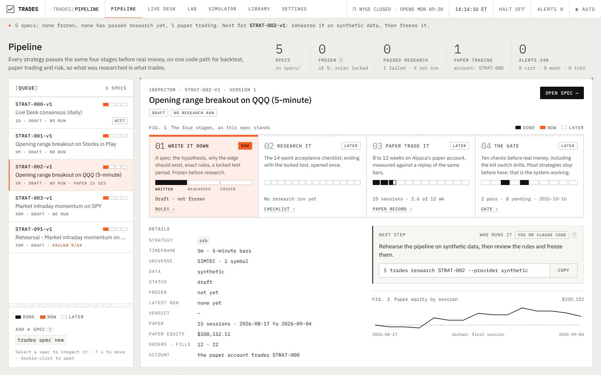

# Trades

**A research, backtest and paper-trading system for US stocks and ETFs, with a web app that
explains every number.** Strategies are written down before they are tested, judged by a
14-point checklist net of costs, paper traded on an Alpaca practice account through the same
code as their backtest, and held to a 10-point gate before anyone even considers real money.

> **No real money.** Trades has no path to a real-money account. Its paper trader talks only to
> Alpaca's *paper* (practice) endpoint, which is hard-coded. It is educational software, not
> investment advice.



## How a strategy earns its way to paper trading

| Stage | You do | The exit test |
| --- | --- | --- |
| **1. Spec** | Write the rules, the rationale and the test dates in `specs/`, then freeze them | frozen and committed before any test |
| **2. Research** | `trades research STRAT-xxx`: train, validation, walk-forward, cost stress | all 14 acceptance checks, including a locked test opened once |
| **3. Paper** | Trade it on an Alpaca paper account for 8 to 12 weeks; `trades track` compares it with a replay | signals match the backtest at least 95%, fills within 1.5x the cost model |
| **4. Gate** | `trades gate`: drills, attestations, a written loss budget | all 10 checks. Passing turns nothing on |

Most strategies fail somewhere along the way. That is the system working: the published
intraday edges look large before costs and are fragile after them. The full procedure, with every
threshold and who may do what, is in **[docs/PLAYBOOK.md](docs/PLAYBOOK.md)**.

## Quick start

Python 3.10+ (3.12 recommended); Node.js 18+ to build the web app.

```bash
python -m venv .venv && source .venv/bin/activate      # Windows: .venv\Scripts\activate
pip install -e ".[dev]"
cd web && npm install && npm run build && cd ..
trades serve                                            # http://127.0.0.1:8000
```

The app starts on an offline synthetic market, so it works without a key or a network. Then try
the pipeline on it:

```bash
trades spec list                                  # the specs and where each one stands
trades research STRAT-002 --provider synthetic    # rehearse a full research run (about 5 minutes); it
                                                  # fails, as it should: the spec is a draft, and
                                                  # synthetic data is never evidence
trades runs show <id>                             # the report, also on the Pipeline screen
```

Docker: `docker compose -f deploy/docker-compose.yml up --build`. Hot reload: `trades serve`, and in
another terminal `cd web && npm run dev` (http://localhost:5173).

## The app

| Screen | What it answers |
| --- | --- |
| **Pipeline** | Where is each strategy, and what do I do next? The kill switch and the alert feed. |
| **Live Desk** | What do the strategies say about my watchlist now, and why? |
| **Lab** | Would this have worked after costs and taxes, and how fragile is it? |
| **Simulator** | How do strategies react bar by bar in markets you can steer (crash, rally, a broken pair)? Can you trade better yourself? |
| **Library** | Every strategy's rules, evidence and failure modes, plus the traps (look-ahead, overfitting, survivorship). |
| **Settings** | Data sources and keys, your account profile, the kill switch and the risk limits. |

Details: [docs/APP.md](docs/APP.md). The design language: [docs/DESIGN.md](docs/DESIGN.md).

## Market data

| Provider | Key | Best for |
| --- | --- | --- |
| **Massive** (formerly Polygon.io) | `MASSIVE_API_KEY` | research: years of 1-minute to daily history |
| **Alpaca** | free paper account | the paper trader, real-time quotes |
| **Yahoo Finance** | none | quick looks, decades of daily bars |
| **CSV files** | none | your own data |
| **Synthetic** | none | rehearsing offline; never evidence |

Downloaded history is cached as parquet (completed bars only; re-checked after splits), so a
research rerun downloads nothing. `trades data check massive` tests a key. Details:
[docs/DATA.md](docs/DATA.md).

## Paper trading

```bash
trades paper status          # kill switch, account, positions, runner heartbeat
trades paper                 # dry run: prints the plan, sends nothing
trades paper --submit        # sends it, for a spec that passed research (Jack only)
trades track                 # paper against a replay of the same bars
trades halt --reason "..."   # kill switch on: nothing trades
trades paper flatten         # cancel everything, close everything, kill switch on
```

A risk engine with eight deterministic checks (`risk/limits.yaml`) reviews every decision. Records
go to `paper/<spec>/`. Running it unattended on a small server (docker compose, systemd timers, a
heartbeat, Telegram alerts, a backstop that flattens a dead runner): [deploy/README.md](deploy/README.md).

## Working with Claude Code

The repository is set up for [Claude Code](https://claude.com/claude-code): `CLAUDE.md` holds the
project's hard rules, `.claude/settings.json` wires hooks that block the human-only files and
commands, and three agents help: `backtest-auditor` (after every research run), `risk-reviewer`
(any change to execution, risk or the engine) and `ui-designer`. The `new-strategy` skill starts a
spec. The rules that matter most:

* Claude never places, changes or cancels real-money orders, and never adds a way to.
* Claude never reads `.env` files or `config/live.yaml`, and never edits `risk/limits.yaml` or
  `config/backtest.yaml`: it proposes changes in chat.
* Only Jack freezes specs, opens locked tests, sends paper orders, runs drills, attests at the gate
  and turns the kill switch off.

Hooks are guardrails, not a security boundary: live keys never live on a machine that runs
Claude Code.

## Documentation

| Document | What it covers |
| --- | --- |
| [docs/PLAYBOOK.md](docs/PLAYBOOK.md) | the four stages, the 14 checks, paper tracking, the 10-point gate, the self-checks |
| [docs/ARCHITECTURE.md](docs/ARCHITECTURE.md) | the one decision path, the risk engine, records, configuration, folders |
| [docs/DATA.md](docs/DATA.md) | providers, Massive's plans, the bar cache, data hygiene, the synthetic market |
| [docs/APP.md](docs/APP.md) | each screen, the Live Desk consensus, the forward journal, adding a strategy, hosting |
| [docs/DESIGN.md](docs/DESIGN.md) | the app's design language |
| [docs/SELLING.md](docs/SELLING.md) | selling tools, not signals: products, platform rules, compliant marketing |
| [deploy/README.md](deploy/README.md) | running the paper trader unattended |

## Development

```bash
pytest -q                          # unit, look-ahead and integration tests
ruff check src tests scripts       # lint
cd web && npm run build            # type-check and build the web app
```

## Disclaimer

For education and research only. Nothing here is investment advice or a recommendation to buy or
sell any security. Backtested results are hypothetical and were prepared with hindsight; past
performance does not predict future results. Trading involves risk of loss.
