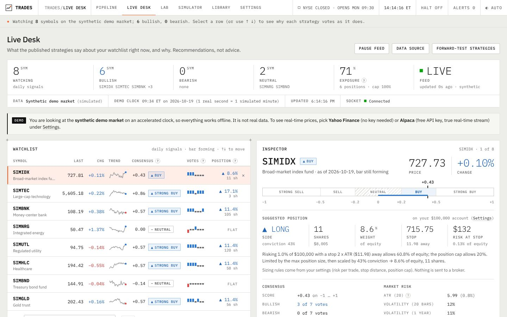
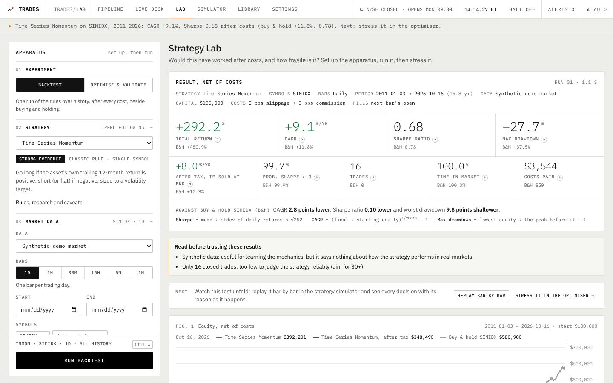
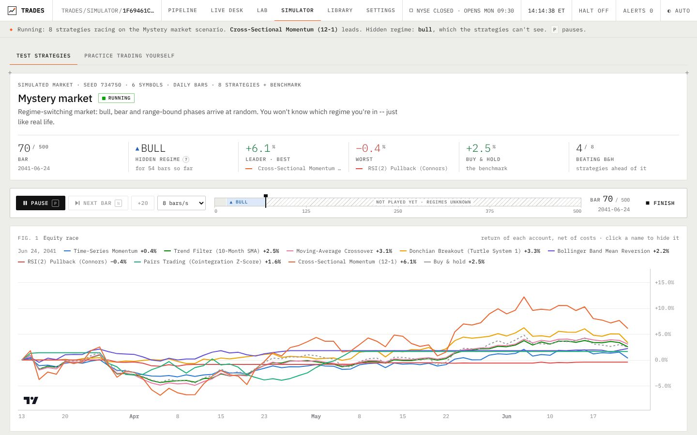

# The web app

`trades serve` opens the app at http://127.0.0.1:8000. It starts on an offline synthetic market
(labelled as such, with an accelerated clock), so everything works without a key or a network;
choose real data in **Settings**. The top bar always shows the New York clock and whether the
market is open, the kill switch (**HALT ON/OFF**) and **ALERTS** (errors, rejections and risk
limits from the paper records in the last 24 hours). Under it, one sentence says what is true
on the screen and what to do next.

| Screen | The question it answers |
| --- | --- |
| [Pipeline](#pipeline) | Where is each strategy on the way to real money, and what do I do next? |
| [Live Desk](#live-desk) | What do the strategies say about my watchlist now, and why? |
| [Lab](#lab) | Would this have worked after costs, and how fragile is it? |
| [Simulator](#simulator) | How do strategies behave bar by bar, in markets I choose? Can I trade better myself? |
| [Library](#library) | What is this strategy, how good is the evidence, how does it fail? |
| [Settings](#settings) | Where does my data come from, what does my account look like, and what protects me? |


## Pipeline

The home screen follows the [playbook](PLAYBOOK.md). On the left, a queue of every spec in
`specs/` with its stage track (spec, research, paper, gate). On the right, an inspector for the
selected spec: the four stages as joined compartments (the 14 research checks, 12 weeks of
paper, the 10 gate checks), the details, and the next step as a command with who may run it.
Below, the kill switch and the alert feed (time in New York, message, `CRIT`/`WARN`/`INFO`).

Open a spec for its detail page, one tab per stage: the spec itself with a to-scale timeline of
its train, validation and locked-test periods; the research checklist and every run; the paper
record (equity, decisions, orders, tracking, daily reports); and the gate.

## Live Desk



Streams quotes for your watchlist (Yahoo with no key, Alpaca or Massive with a key, or the demo
market), runs every enabled strategy on each completed bar, and shows a consensus. Each
strategy's vote comes with the rule it applied, how long the signal has held, its backtested
record on *this* symbol, and a risk-based position size with a protective stop. A neutral
consensus suggests no position, and a portfolio cap keeps all suggestions together within 100% of
your account. **It is not advice**: it is the output of published rules, explained.

### The consensus

The consensus is itself a strategy (`consensus`), so you can backtest what the Live Desk would
have told you. One function, `trades.strategies.consensus.decide`, goes from votes to a position,
and both the Live Desk and the strategy call it:

1. **Score.** The average vote of the strategies not warming up (+1 bullish, 0 neutral, −1
   bearish). Four of the eight default strategies are trend rules and a fifth is momentum, so
   their votes are correlated: **Settings → Combine the votes → By category** averages within
   each category first, so agreeing trend rules count once.
2. **Action.** Score ≥ +0.2 buy (≥ +0.5 strong buy); ≤ −0.2 sell, or short if shorting is allowed;
   anything between is **neutral, with no position**.
3. **Weight.** Conviction (the absolute score) × min(risk per trade × price / (stop ATRs × ATR(20)),
   max position). Account equity cancels out, so the weight is the same on any account size.
4. **Portfolio cap.** If the suggestions add up to more than the cap (100% of equity by default),
   each one shrinks in proportion.

Every strategy runs on the dates all watchlist symbols share, as in a backtest (so a recently
listed symbol moves everyone's first bar, and the Live Desk says so). Tests run the Live Desk on
data cut off at several bars, including a symbol that starts later and one missing a day, and
check it gives the same action and weight as the strategy. The suggested position shows the
weight its whole shares hold next to the target, and says when the target is less than one
share. Rules re-checked on a schedule (every 21 bars, a
monthly rebalance) count from the first bar of history, so daily history always starts on
2 January 2008: the Live Desk, `trades recommend`, the journal and backtests check on the same days.

### The forward journal

A backtest tests rules chosen after seeing the history. The journal records the Live Desk's calls
*before* their outcome exists and scores them later. `journal/experiment.json` fixes the
watchlist, strategies, weighting, risk settings, benchmark and providers; every row carries the
experiment id and the code version (marked `+dirty` when the code has uncommitted changes), and
changing a rule starts a new experiment.

```bash
trades journal record     # after the close; does nothing on weekends and holidays, never logs stale data
trades journal score      # rewrites journal/REPORT.md: excess return over SPY at 5 and 21 sessions
```

Outcomes run from the next session's open (when a backtest would fill) to the close 5 and 21
sessions later, minus SPY. Days, not rows, are the unit (symbols on one day move together), and
only non-overlapping days count. Outcomes are before costs and taxes, and SPY's own rows are left
out (against itself its excess is always zero). Below about 60 independent days the report says it
is too early to conclude anything; at 21 sessions that takes about five years. GitHub Actions runs
both after every weekday close (`.github/workflows/journal.yml`) and commits the new rows even if
scoring fails; its paper job skips itself when the repository has no Alpaca paper keys.

## Lab



Backtests any strategy on any symbols and dates, with next-bar fills, slippage, commissions and
short-borrow fees. It shows readouts first (return, Sharpe and the probability it is really above
zero, drawdown, trades, costs), then the equity and drawdown figures against buy-and-hold, monthly
returns, the trade list and **after-tax** results for your account. A **cost sensitivity** card
reruns the test at 2x and 4x every trading cost (spread, slippage, commissions and fees) and says
when double costs would wipe the account out. Parameter optimisation reports the **deflated Sharpe
ratio** (how likely the "best" result is luck), and **walk-forward** testing scores parameters
only on data the optimiser never saw. **Replay bar by bar** sends any backtest to the simulator.

The Lab is for exploring. Evidence for real money comes only from `trades research` on a frozen
spec (the Pipeline), which logs every variant and keeps a test period locked.

## Simulator



**Test strategies.** Pick strategies and a market and press play. Each strategy is an
independent trader with its own paper account: it decides at each bar's close using only the
bars so far and fills at the next open, through the backtest's own execution engine. A test
checks that a strategy traded bar by bar produces exactly the equity curve of a backtest over the
same bars, events included.

* **Steer a simulated market**: regime-switching (bull, bear, range, scripted stories) with GARCH
  volatility, fat tails, jumps, a one-factor structure and a cointegrated pair. Mid-run, inject a
  crash, a rally, a volatility spike, a forced regime, an earnings gap or a pair break.
  Randomness is seeded per bar, so the same seed with and without your crash differs *only* by
  the crash: a controlled experiment.
* **Replay history** at anything from half a bar to 200 bars a second, or **forward-test in real
  time** on Yahoo, Alpaca or Massive data, trading each bar as it completes.
* **Modern vs classic**: race each modern method against the classic rule it refines.
* **See why**: the event feed lists every signal change and trade with the strategy's reasoning;
  at the end, risk-adjusted results and each strategy's return inside every hidden regime.

**Practice trading.** Trade yourself, one bar at a time, with market, limit, stop and bracket
orders, on synthetic scenarios (crash, bubble, chop) or famous real periods (2008, COVID, the
dot-com bust) in **blind mode**, where ticker, dates and price level stay hidden until the end.
You race the strategies, then get a scorecard on *process*: stop use, position sizing, cutting
losses, the disposition effect, over-trading and journaling.

## Library

Every strategy as a data sheet: rules, rationale, failure modes, an evidence rating and
references, grouped into classic published rules and modern quant methods (each modern method
names the classic rule it refines, with one click to race the two). Plus short explainers on
look-ahead bias, overfitting, survivorship, costs, the Sharpe ratio's uncertainty, position
sizing, behavioural biases, and why an AI model's stock picks cannot be backtested (it was trained
on text from after the backtest's dates, so only predictions logged in advance can test it).

### Classic published rules

| Strategy | Category | Evidence | Key reference |
| --- | --- | --- | --- |
| Time-series momentum | Trend following | Strong | Moskowitz, Ooi & Pedersen (2012), *JFE* |
| Trend filter (10-month SMA) | Trend following | Moderate | Faber (2007), *J. Wealth Management* |
| Moving-average crossover | Trend following | Moderate | Brock, Lakonishok & LeBaron (1992), *JF* |
| Donchian breakout (Turtle System 1) | Trend following | Moderate | Faith (2007), *Way of the Turtle* |
| Bollinger band mean reversion | Mean reversion | Practitioner | Bollinger (2001); Lehmann (1990) |
| RSI(2) pullback | Mean reversion | Practitioner | Connors & Alvarez (2008) |
| Pairs trading (cointegration z-score) | Statistical arbitrage | Moderate | Gatev, Goetzmann & Rouwenhorst (2006), *RFS* |
| Cross-sectional momentum (12-1) | Momentum | Strong | Jegadeesh & Titman (1993), *JF* |
| 52-week-high momentum | Momentum | Strong | George & Hwang (2004), *JF* |
| Dual momentum | Momentum | Practitioner | Antonacci (2014) |
| Low-volatility anomaly | Defensive factor | Strong | Ang et al. (2006), *JF*; Frazzini & Pedersen (2014), *JFE* |
| Short-term reversal | Mean reversion | Moderate | Lehmann (1990); Jegadeesh (1990) |
| Buy and hold | Benchmark | — | Sharpe (1991), *FAJ* |

### Modern quant methods

They adapt where the classic rules are fixed, and that flexibility makes them easier to overfit,
so each names the classic rule it refines.

| Strategy | What it adds | Refines | Evidence |
| --- | --- | --- | --- |
| Multi-horizon trend (CTA signal) | three volatility-normalised EMA gaps through a response curve; a continuous position | Time-series momentum | Moderate |
| Statistical arbitrage (factor residuals) | trades the Ornstein-Uhlenbeck residual of each stock's market-driven moves, market-neutral | Short-term reversal | Moderate |
| Residual momentum | ranks stocks by their stock-specific return, so a high-beta rally is not momentum | Cross-sectional momentum | Moderate |
| Pairs trading (Kalman filter) | the hedge ratio is a hidden state updated every bar | Pairs trading (cointegration) | Practitioner |
| Regime switching (hidden Markov model) | a two-state HMM refitted monthly; invested while the calm regime is likely | Trend filter | Moderate |
| Machine-learning ranker (walk-forward ridge) | pooled ridge regression on ten price features, purged walk-forward retraining | Cross-sectional momentum | Experimental |

### Intraday rules

The opening range breakout (on one ETF, or on "Stocks in Play" filtered by relative volume) and
intraday momentum, with protective stops and closing-auction exits. These are the specs in
`specs/` that the Pipeline researches; their costs dominate their results, so read their
spec's cost section first.

## Settings

* **Market data**: choose the provider and enter keys (stored on this machine only, mode 0600,
  masked when read back). **Test connection** makes one cheap request. See [DATA.md](DATA.md).
* **Your account**: starting equity, fractional shares, account type (taxable or tax-advantaged)
  and short- and long-term tax rates (estimates: use your own bracket). These are the defaults for
  the Lab, the simulators and the Live Desk. After-tax results split each year's gains into short-
  and long-term, net them and carry losses forward. Gains on short sales are always short-term,
  and commissions reduce taxable gains in the year they are paid. Simplifications: average cost,
  no wash-sale rule, federal tax only.
* **What protects you**: the kill switch, and the risk limits from `risk/limits.yaml`, read-only
  (only Jack edits that file).

## Keeping results honest

* **No look-ahead.** Signals use data up to a bar's close and fill at the next bar's open. The test
  suite cuts the data at several points and checks that no strategy's past signals, indicators or
  sizes change when future bars arrive.
* **Costs are always on.** The Lab and the simulators charge the slippage and commission set in
  Settings (5 bps of slippage per fill by default), short-borrow fees and margin interest.
  Research runs use the full cost model in `config/base.yaml` (half the spread, slippage, extra
  slippage on stops, regulatory fees on sales) and stress it at 2x. The Lab warns when costs eat
  most of the gross profit.
* **Statistics that say how much to trust a number**: the probabilistic Sharpe ratio on every
  backtest, the deflated Sharpe ratio on every search, walk-forward on demand.
* **Models learn only from the past**: the HMM refits on trailing returns; the ranker trains only on
  rows whose target was known before the prediction date and reports its live out-of-sample
  information coefficient.
* **Plain-language warnings** for few trades, short samples, likely overfitting, synthetic data and
  survivorship bias.
* **Live data stays clean**: extended-hours prints never alter daily bars, and a forming bar never
  feeds statistics or a decision.

## Adding your own strategy

Start with a spec (`trades spec new`, or ask Claude Code to use the `new-strategy` skill), then a
small class: declare its parameters and metadata, and compute a `signal` column (+1 long, −1
short, 0 flat) from data up to each bar. Register it in `src/trades/strategies/__init__.py` and
it appears in the Lab, the Live Desk and the simulator; the no-look-ahead test runs against it
automatically, so a rule that peeks at future bars fails the suite.

```python
import numpy as np
import pandas as pd

from trades.features import indicators as ind
from trades.strategies.base import Evidence, Param, Reference, SingleAssetStrategy


class RSITrend(SingleAssetStrategy):
    id = "rsi_trend"
    name = "RSI trend (example)"
    category = "Trend following"
    summary = "Long while 14-bar RSI is above 55, flat below 45."
    rules_text = ("RSI(14) > 55 -> long", "RSI(14) < 45 -> flat")
    rationale = "Momentum persists over short horizons."
    failure_modes = "Choppy markets."
    evidence = Evidence.PRACTITIONER
    evidence_text = "Illustrative example, not a researched strategy."
    references = (Reference("Wilder, J. W.", 1978, "New Concepts in Technical Trading Systems", "Trend Research"),)
    params_spec = (Param("length", "RSI length", 14, "int", 2, 50),)

    def warmup(self) -> int:
        return self.params["length"] + 1

    def compute(self, df: pd.DataFrame) -> pd.DataFrame:
        r = ind.rsi(df["close"], self.params["length"])
        raw = pd.Series(np.where(r > 55, 1.0, np.where(r < 45, 0.0, np.nan)), index=df.index)
        return pd.DataFrame({"signal": raw.ffill(), "rsi": r}, index=df.index)
```

## Put it online

The app is a server that keeps running (it streams prices and simulator bars over WebSockets),
so static hosts such as Vercel or Netlify cannot run it; any container host can. The repository
includes a blueprint for [Render](https://render.com):

[](https://render.com/deploy?repo=https://github.com/jackr930/Trades)

Set `TRADES_PASSWORD` to a long password when Render asks (anyone with it can use the app and
change its settings). The free plan sleeps after 15 idle minutes, runs slower, and has no
persistent disk, so set lasting choices as environment variables (`TRADES_PROVIDER=yahoo`,
`APCA_API_KEY_ID`, `MASSIVE_API_KEY`, ...). Elsewhere: the server listens on `$PORT` when set; add
outside host names to `TRADES_ALLOWED_HOSTS` (Trades then refuses to serve without a password)
and set `TRADES_SECRET_KEY` so logins survive restarts. While nobody has the Live Desk open, the
live feed pauses to save CPU and data quota.

The paper trader is a different deployment, on a machine you control: see
[deploy/README.md](../deploy/README.md).

## Limitations

* US equities and ETFs only (the NYSE calendar); no options, futures or crypto.
* The fill model is bar-based: no partial fills, volume limits or queue position. When a bar
  touches both the stop and the take-profit, the stop is assumed to fill first.
* Free data has gaps: Yahoo is unofficial, Alpaca's free feed is one exchange, and only a paid
  source gives a survivorship-free universe.
* Simulations live in memory, and the app is single-user.
* Published strategies weaken after publication (McLean and Pontiff, 2016). Treat them as
  disciplined baselines, not promises.
